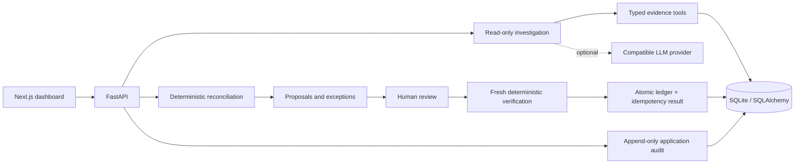

# ReconcileAI

**Intelligent financial reconciliation, with every decision accounted for.**

ReconcileAI is a working financial operations prototype that reconciles fictional invoices and bank transactions, investigates discrepancies, and posts approved settlements to a simulated ledger. It is designed around a strict boundary:

> AI proposes. Deterministic systems verify. Humans approve. Transactional infrastructure executes.

The entire workflow runs without an LLM API key. Optional model integration uses an OpenAI-compatible chat-completions endpoint and a bounded set of read-only tools. No model output can authorize a financial write.

## What works

- JSON and CSV imports with integer-cent validation, unique external references, atomic failure, and repeat-import detection.
- Explicit matching precedence for references, dates, currencies, counterparties, payment direction, and split payments.
- An exception inbox for duplicates, missing payments, partial payments, over/underpayments, conflicting references, ambiguous counterparties, unknown references, and unmatched receipts.
- Typed investigation tools, provider timeouts, tool budgets, reference validation, and clearly labeled rule-generated fallback.
- Versioned human approval and rejection, with fresh evidence verification before approval and posting.
- Atomic ledger settlement and idempotency persistence; retries with the same or different keys cannot post the same proposal twice.
- Audit history, action filters, JSON export, financial metrics, responsive review screens, and live Recharts visualization.
- Deterministic fixtures, concurrent request tests, failure injection, an evaluation runner, and a real-browser workflow test.

## Architecture



**Backend:** Python 3.12+, FastAPI, Pydantic v2, SQLAlchemy 2, SQLite WAL, pytest, httpx, Ruff. **Frontend:** Next.js App Router, React, strict TypeScript, Tailwind CSS, an adapted shadcn/ui button component, Recharts, and Playwright. Python direct dependencies and the frontend lockfile are pinned; CI uses Python 3.13 and Node 24.

## Run locally

Use Python 3.13 and Node 24 LTS. Run backend commands from the repository root so the fixture and `.env` paths resolve consistently.

```bash
git clone https://github.com/sarseej-shrestha/ReconccileAI.git
cd ReconccileAI
python3.13 -m venv .venv
source .venv/bin/activate
pip install -e './backend[dev]'
cp .env.example .env
python -m app.cli load
python -m uvicorn app.main:app --host 127.0.0.1 --port 8000
```

In a second terminal:

```bash
cd ReconccileAI/frontend
npm ci
npm run dev
```

Open **http://localhost:3000**. API documentation is at **http://127.0.0.1:8000/docs**. Next.js proxies `/api` to the backend, keeping the browser on one origin. For a production frontend build, run `npm run build` followed by `npm start`.

### Configuration

| Variable | Default / purpose |
| --- | --- |
| `DATABASE_URL` | `sqlite:///./reconcileai.db`; SQLite only in this prototype |
| `FRONTEND_ORIGIN` | `http://localhost:3000`; direct API CORS origin |
| `DEMO_REVIEWER_TOKEN` | `local-demo-reviewer`; deliberately public simulated reviewer identity |
| `LLM_API_KEY` | Empty selects rule-generated investigation |
| `LLM_BASE_URL` | Compatible provider URL ending in `/v1` |
| `LLM_MODEL` | Configurable model identifier; example default in `.env.example` |
| `LLM_TIMEOUT_SECONDS` | 15 seconds per provider request, at most four provider turns |
| `BACKEND_URL` | Frontend process/build variable; defaults to `http://127.0.0.1:8000` |

Set provider credentials only in the backend environment or ignored `.env`. They are never sent to the frontend. Configure a trusted provider endpoint; imported transaction text cannot choose it. No live paid-provider call is needed for the demo or CI.

### Demo data and reset

```bash
# Load or repeat the identical import without duplicates:
python -m app.cli load
# Explicitly discard this local demo's records AND audit history, then reload:
python -m app.cli reset --yes
# Regenerate the checked-in fictional dataset:
python scripts/generate_fixture.py
```

The fixture contains **24 invoices, 34 transactions, and 14 labeled invoice exception cases**, including the reviewable split payment. A fresh reconciliation creates **11 proposals and 24 exception records**: 14 invoice cases plus 10 unmatched transactions. The ledger starts empty intentionally; the demo creates genuine ledger records through approval and posting, preserving their provenance.

The split example is `INV-010`: **USD 1,250.00**, paid by `TX-010` (**USD 750.00**) and `TX-011` (**USD 500.00**). `INV-022` demonstrates a negative vendor payment. All companies, references, and account sources are fictional.

### CSV imports

Use the workspace's **Invoices** or **Transactions** tab and **Import CSV**. Amounts are signed integer cents, never decimal strings. The upload limit is 1 MB. A conflicting identifier or malformed row rolls back the entire import.

Invoice columns:

```csv
id,invoice_number,counterparty,amount_cents,currency,issue_date,due_date,kind
INV-NEW,INV-NEW,Fable Example Ltd,125000,USD,2026-09-01,2026-09-30,receivable
```

Transaction columns:

```csv
id,external_reference,counterparty,amount_cents,currency,date,description,source
TX-NEW,FICTIONAL-NEW,Fable Example Ltd,125000,USD,2026-09-15,INV-NEW,Fictional Demo Bank
```

## Verify

```bash
source .venv/bin/activate
pytest backend/tests -q
ruff check backend evaluation scripts/generate_fixture.py
ruff format --check backend evaluation scripts/generate_fixture.py
python -m evaluation.run
cd frontend
npm run lint
npm run typecheck
npm run build
npx playwright install chromium
cd ..
node scripts/browser-check.mjs
```

The browser harness starts both real servers, uses a temporary SQLite database, performs the full operator workflow, checks rejection and replay safety, exports audit JSON, captures desktop/mobile screenshots, and stops its servers. Keep ports 8000 and 3000 free. `CHROMIUM_PATH` or `--browser /path/to/chromium` selects an existing browser; `REVIEW_OUTPUT` selects an artifact directory.

**Verification:** 71 backend tests and an 11-check real-browser workflow passed locally and in [GitHub Actions](https://github.com/sarseej-shrestha/ReconccileAI/actions/runs/38688170027); frontend lint, type checking, and production build also passed.

[Measured evaluation results](evaluation/results.json): **11/11 expected candidate matches, zero false positives, zero false negatives, 100% precision and recall, 100% classification accuracy across 14 invoice exception cases, and 54.17% abstention across 24 invoices.** These are small, hand-labeled development-fixture results, not held-out production benchmarks or model accuracy claims. See [evaluation methodology](docs/evaluation.md).

## Demonstrate and discuss

Follow the [90-second demo](docs/demo.md) and review the [interview questions and resume bullets](docs/interview.md). Read [architecture](docs/architecture.md), [design decisions](docs/design-decisions.md), and the [verification report](docs/verification.md) for transaction boundaries, failure semantics, and test evidence.

## Deliberate limits

This is a **local, single-tenant financial operations prototype**, not a production payment service. Authentication is simulated; it must not be exposed publicly with the demo token. It has no bank connections, exchange-rate inference, production secrets infrastructure, or automated fund transfers. The ledger records settlements rather than a complete double-entry general ledger.

Only full settlements of one invoice, including up to six explicitly referenced split payments, can post. Partial payments are classified but require further evidence; allocations spanning multiple invoices, write-offs, refunds, fuzzy-only matches, and currency conversion abstain. Exact counterparty normalization removes punctuation and case; it does not infer that two similarly named companies are the same legal entity.

SQLite serializes writers and waits up to 15 seconds for locks. This is appropriate for a small demonstration, not high write throughput. Schema initialization uses SQLAlchemy `create_all`; destructive demo reset replaces a migration system for this first schema version. Audit records are append-only through application APIs and ORM guards, **not tamper-proof** against database administrators. The dashboard shows the latest 1,000 audit events and exports up to 10,000 per action filter.

Production work would add real identity and authorization, tenant isolation, PostgreSQL migrations and locking, controlled reconciliation overrides, balanced journal accounting, durable failure telemetry, rate limits, observability, backup/restore, and evaluation on independently labeled financial records. See [the production roadmap](docs/design-decisions.md#production-readiness).
