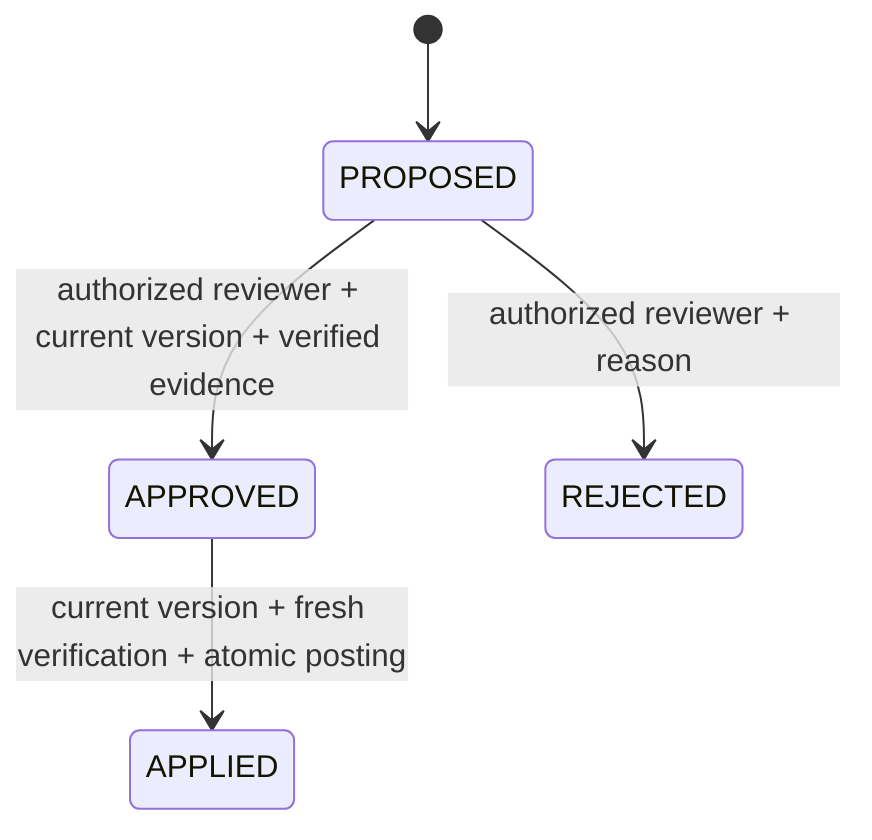

# Architecture and financial boundaries

## Persistence model

Invoices, bank transactions, proposals, allocations, exceptions, approvals, posting operations, ledger entries, idempotency records, and audit events have separate relational tables. Allocation rows connect invoice and transaction foreign keys to a proposal; no join identifier is accepted solely from model prose. Proposal evidence is an inspectable JSON snapshot, while allocations remain normalized relational records.

Invoice amounts and ledger amounts are positive integer cents. Bank amounts are signed: positive for receivables, negative for vendor payments. Currency comparisons are exact; USD, EUR, GBP, and CAD are supported as two-decimal currencies. No exchange rate is inferred. Arithmetic uses Python integers; the browser formats cents with `BigInt` rather than floating-point division. Database uniqueness covers invoice numbers, external bank references, evidence signatures, one approval per proposal, one posting operation per proposal, and one ledger consumption per transaction.

## Matching precedence

1. Find explicit `INV-…` references; if none refer to the invoice, consider exactly normalized counterparties.
2. Reject conflicting or unsupported references, cross-currency candidates, incorrect signs, duplicate-looking transactions, and candidates outside the date window.
3. Require matching counterparties even when an invoice reference is present. A reference alone is not proof.
4. Abstain when a no-reference candidate could belong to multiple open invoices for the counterparty.
5. Compare exact absolute cents. A single fully matching reference is `reference_exact`; a unique no-reference amount/counterparty/date match is `date_window`.
6. Up to six explicitly referenced transactions totaling one invoice become a reviewable `split_payment`. The engine does not search arbitrary subsets that could conceal an overpayment.
7. Smaller totals become `underpayment` or `partial_payment`; larger totals become `overpayment`. No candidates means `missing_payment`.

The date window is seven days before issue through thirty days after due date. Duplicate detection groups counterparty, amount, currency, date, and parsed invoice references. This deliberately conservative heuristic may flag legitimate identical installments for follow-up. Uncovered open transactions become unmatched exceptions.

Reconciliation only proposes; it never posts. Evidence hashes deduplicate repeated runs. Applied invoices and posted transactions leave the candidate pool. Rejected proposals are not silently reopened. Exceptions resolve when their current evidence no longer appears or their invoice is settled. Imports preserve existing records: the same ID and identical content is a no-op; changed content is a conflict.

## Fresh verification and state transitions

Approval and posting recompute candidate classification from the current database and compare its SHA-256 fingerprint with the stored evidence signature. This catches modified amounts, currencies, references, counterparties, dates, and newly imported conflicting payments. Allocation amounts and transaction membership must also equal the recomputed evidence, and totals must exactly satisfy the invoice. Model confidence does not participate.

A rejected proposal cannot apply. Version checks reject stale UI decisions; the unique approval constraint and serialized writes prevent concurrent reviewers from creating multiple decisions. A failed posting rolls back to APPROVED, allowing a safe retry. A separate audit event records the failure after rollback. Application-level audit persistence may itself fail during a database outage; durable external telemetry is a production requirement.

## Exactly-once effects within SQLite

All mutation sessions execute `BEGIN IMMEDIATE` **before reads**. This acquires SQLite's writer reservation before checking approval, allocation, or idempotency state. Reads use explicit `BEGIN`; foreign keys and WAL are enabled, and the lock timeout is 15 seconds.

Within a single transaction, posting:

1. Looks up the idempotency key and compares a canonical request fingerprint containing proposal ID, version, and operation type.
2. Returns the stored result for an identical request. A reused key with different payload returns 409.
3. Checks whether the proposal already has a posting operation. A different key returns that operation with no new ledger entries.
4. Checks the approved version, recorded human approval, and current evidence.
5. Creates the unique operation and ledger allocations, updates invoice/transaction/proposal states, resolves relevant exceptions, writes audit events, and stores the idempotency result.
6. Commits all effects together.

Database uniqueness backs up the application checks. A crash before commit leaves no partial effects; a lost response after commit can be retried with the same key. The API response distinguishes the stored business result from request-specific `replayed` and `additional_entries` metadata. Repeated requests do create audit events, but never additional financial effects.

The guarantee is local **exactly-once effect**, not exactly-once delivery or a distributed transaction. PostgreSQL would retain uniqueness constraints and atomic result storage, use transaction-scoped row locking for proposals/invoices, handle unique-key races with retryable transactions, and add an outbox for external integrations.

## Investigator boundary

The investigator has six allowlisted tools: invoice lookup, transaction lookup, candidate search, ledger inspection, amount difference, and reconciliation history. Pydantic rejects unknown arguments and invalid identifiers. Differences refuse repeated references, cross-currency sums, and wrong-direction payments. There are at most eight tool calls, including initial deterministic evidence collection, and four provider turns. Each provider request has a timeout.

External inference runs outside a write transaction. Its evidence is advisory and may become stale while it runs; financial operations always verify again. API keys and provider URLs come from server configuration, never imported descriptions. Imported strings appear as explicitly labeled untrusted JSON evidence; they cannot register tools or change the allowlist.

Provider outputs must match a strict schema and agree with independently derived financial facts and referenced entities. Unknown references, classifications, amounts, writeback requests, malformed output, and transport failures select the rule-based fallback. Free-form provider prose and confidence are not displayed as accounting evidence: the renderer uses the verified fact summary and rule uncertainty. `rules`, `rules_fallback`, and `llm_validated` distinguish behavior honestly. Uncertainty is categorical, not calibrated probability.

The agent does not receive approval or ledger functions. Its only writes are the service's investigation audit records. This prototype uses model tools to inspect and corroborate evidence, not to override deterministic classification.

## API and interface

The frontend uses a same-origin Next.js rewrite to FastAPI. All dashboard metrics and charts are computed from database rows, with payment volume grouped by currency. The review drawer displays candidate transactions, exact discrepancy, verification, tool trace, and actual state/version. The approval dialog collects a reason and the simulated reviewer token. The posting control retains its key and original request version in session storage so an explicit retry repeats the request.

Successful import audit events retain the created record snapshots and unchanged record identifiers, so an export can reconstruct imported evidence as well as counts. Audit reads support action and entity filters. Export is JSON. Mutation routes for audit history do not exist, and ORM update/delete hooks reject accidental changes. Administrators can still edit the SQLite file directly.
